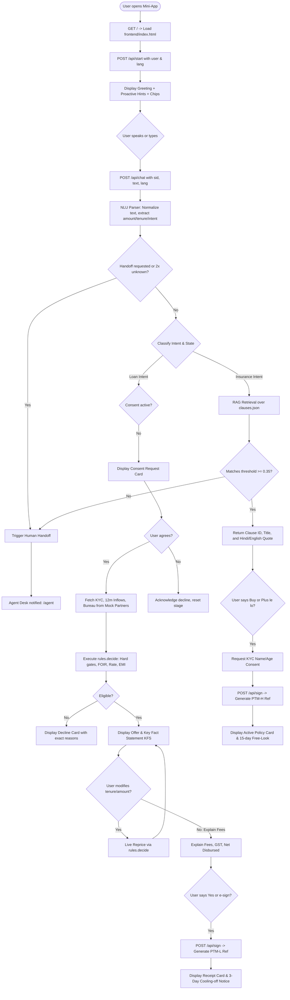
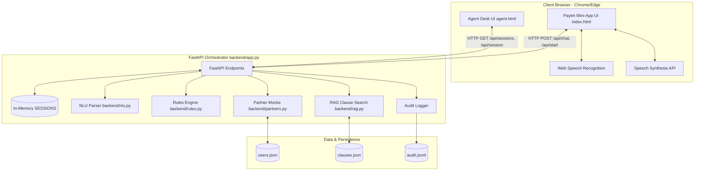

# Product Requirements Document (PRD)
## Paytm Voice Assistant · Voice-First Loans & Insurance Journeys

---

### Document Control
- **Product Name:** Paytm Voice Assistant (Fintech Journeys That Talk Back)
- **Track:** Paytm Build for India AI Hackathon | Track 2: AI-Powered Financial Journeys
- **Document Version:** 1.0.0
- **Document Status:** Complete / Baseline Audit
- **Target Audience:** Product Engineering, Hackathon Evaluation Jury, Solutions Architects, Compliance & Risk Officers

---

## 1. Executive Summary

### 1.1 Project Name
**Paytm Voice Assistant (Track 2: AI-Powered Financial Journeys)**

### 1.2 Product Overview
Paytm Voice Assistant is a voice-first, bilingual (Hindi and English) conversational financial journey orchestrator embedded within the Paytm mini-app ecosystem. It eliminates multi-page application forms, jargon-heavy policy documents, and manual uploads by allowing small merchants and retail users to discover, evaluate, negotiate tenure on, and e-sign micro-loans and health insurance policies through spoken conversation.

The platform couples a conversational Natural Language Understanding (NLU) interface with a **deterministic financial rules engine** and a **clause-level Retrieval-Augmented Generation (RAG) system**. Financial figures (EMI, processing fees, interest rates, net disbursement, total repayment) are calculated deterministically by rules rather than generated by generative models, ensuring mathematical precision and strict compliance with Reserve Bank of India (RBI) and Insurance Regulatory and Development Authority of India (IRDAI) digital lending directives.

### 1.3 Problem Statement
Digital financial inclusion in India suffers from high drop-off rates (>70%) at application stages:
1. **Jargon Obscurity:** Insurance exclusions, waiting periods, room-rent sub-limits, and loan foreclosure fees are buried in fine print.
2. **Paperwork Friction:** Users must re-enter personal and business data that Paytm already holds, requiring repetitive document uploads.
3. **English-First Disconnect:** Financial interfaces prioritize formal English forms, whereas Bharat’s micro-merchants think, operate, and negotiate in Hindi or vernacular languages.

### 1.4 Proposed Solution
A voice-first assistant that provides:
- **Explain:** Interprets loan and insurance clauses in plain spoken Hindi/English, citing the exact contract clause.
- **Decide:** Queries user-consented transaction history, KYC records, and credit scores to render real-time eligibility decisions without document uploads.
- **Guide:** Proactively surfaces personalized financial triggers (e.g., pre-festival working capital needs).
- **Hand Over:** Gracefully transfers complex, sensitive, or low-confidence interactions to a human agent desk alongside the full conversation transcript.

### 1.5 Product Vision
To empower India's 30+ million merchants and next-billion users to access financial liquidity and health security without ever filling a form or translating unfamiliar jargon, using natural spoken dialogue backed by transparent, explainable decisioning.

### 1.6 Primary Objectives
1. **Reduce Journey Time:** Decrease loan and insurance application duration from days/hours to under 3 minutes (~70% reduction).
2. **Eliminate Document Uploads:** Leverage existing platform telemetry (12-month Paytm merchant inflows, KYC, bureau telemetry) via explicit consent.
3. **Prevent AI Hallucination in Finance:** Enforce separation between language understanding and financial calculation; the AI explains, but code sets all monetary values.
4. **Ensure Regulatory Compliance:** Implement DPDP-aligned revocable consent, RBI Key Fact Statements (KFS), 3-day loan cooling-off periods, and 15-day insurance free-look windows.

---

## 2. Problem Definition

### 2.1 Problems the Application Solves
- **Intimidation by Complex Forms:** Kirana store owners and micro-entrepreneurs abandon multi-step web forms requiring manual entry of turnover, PAN, Aadhaar, and bank statements.
- **Hidden Gotchas at Claim Time:** First-time insurance buyers discover room rent caps and 4-year pre-existing disease waiting periods only after hospitalization.
- **Drop-off During Loan Customization:** Users wanting different tenure or loan amounts are forced into fixed tiers without transparent fee breakdowns.

### 2.2 Target Users & Personas

#### Persona 1: Sunita (Eligible Kirana Store Owner)
- **Demographics:** Age 34, Kanpur, Uttar Pradesh.
- **Context:** Runs a busy neighborhood kirana store with high daily UPI soundbox transactions. Needs ₹2,00,000 for pre-Diwali stock purchase.
- **Behavior:** Prefers speaking in spoken Hindi ("Mujhe dukaan ke liye 2 lakh ka loan chahiye"). Has verified KYC, strong bureau score (724), and steady monthly inflows (~₹89,000/mo).
- **Outcome:** Instant eligibility, transparent EMI and fee explanation, live re-pricing to 24 months, and immediate e-signature.

#### Persona 2: Rahul (Subprime Street-Food Vendor)
- **Demographics:** Age 41, Noida, Uttar Pradesh.
- **Context:** Operates a food cart experiencing seasonal cash-flow dips.
- **Behavior:** Verified KYC, but credit bureau score is 598 (below the 650 minimum threshold).
- **Outcome:** Clear, non-punitive decline explanation citing low bureau score, with immediate routing to human credit counseling or alternative support.

#### Persona 3: Meena (New User Without KYC)
- **Demographics:** Age 22, Jaipur, Rajasthan.
- **Context:** First-time digital user looking for starter health cover or small emergency loan.
- **Behavior:** Has not completed video KYC; short platform vintage (2 months).
- **Outcome:** Explicit decline indicating missing KYC prerequisites, preventing fraudulent or non-compliant disbursements.

---

## 3. Product Scope

### 3.1 Core Functionalities
- **Bilingual Voice & Text Input:** Spoken or typed interactions in Hindi (`hi-IN`) and English (`en-IN`).
- **Contextual Inflow & Life-Event Guidance:** Startup banner surfacing contextual hints based on Paytm transaction history.
- **Revocable Data Consent:** Explicit, purpose-limited data authorization modal conforming to DPDP Act principles.
- **Deterministic Loan Decisioning:** Real-time eligibility evaluation based on KYC, bureau score, 12-month inflows, FOIR (Fixed Obligation to Income Ratio) caps, and tiered interest rates.
- **Live Loan Repricing:** Dynamic recalculation of EMI and total repayment upon tenure or amount change during conversation.
- **Key Fact Statement (KFS) Transparency:** Itemized breakdown of processing fee, 18% GST, net disbursed amount, interest rate, and total repayment.
- **Clause-Grounded Insurance Q&A (RAG):** TF-IDF retrieval over insurance and loan terms; cites exact clause ID and wording.
- **Side-by-Side Policy Comparison:** Structured comparison matrix between Basic and Plus health insurance plans.
- **Mock e-Signature & Receipts:** Digital confirmation with unique traceable transaction references (`PTM-L-...` / `PTM-H-...`).
- **Human Agent Escalation Desk:** Handoff trigger upon explicit user request, low RAG confidence, or repeated misunderstanding.
- **Audit Logging:** Tamper-evident session timeline recorded in-memory and persisted to `backend/audit.jsonl`.
- **Zen Mode (Accessibility):** Low-contrast, high-calm visual theme with reduced animation and slower speech synthesis rate.

### 3.2 Out-of-Scope Features (Current Hackathon Prototype)
- Real Aadhaar OTP / UIDAI biometric verification.
- Live external credit bureau (CIBIL/Experian) API integrations.
- Production payment gateway debit mandates / NACH e-mandates.
- Multi-party video KYC flows.
- Speech-to-Text beyond browser Web Speech API.

---

## 4. User Roles and Use Cases

### 4.1 User Types
1. **Customer (Borrower / Policyholder):** Accesses `/` mini-app interface; converses via voice or text; grants or revokes consent; reviews offers; signs agreements.
2. **Human Support Agent:** Accesses `/agent` desk; reviews transferred sessions; reads real-time transcripts, decision state, and audit logs to continue customer assistance without repeated questioning.
3. **Auditor / Compliance Officer:** Inspects `/api/audit/{sid}` and `backend/audit.jsonl` to ensure all decisions trace back to approved rules and verified consent timestamps.

### 4.2 Primary Use Cases & User Stories
- **US-01 (Voice Loan Request):** As a merchant, I want to ask for a loan in spoken Hindi so that I do not have to struggle with complex written forms.
- **US-02 (Consent Transparency):** As a user, I want to see exactly what data is being fetched (KYC, inflows, bureau) and be able to revoke consent at any time.
- **US-03 (Tenure Customization):** As a borrower, I want to change loan tenure (e.g. from 36 to 24 months) by speaking and immediately see the revised EMI.
- **US-04 (Insurance Clarity):** As a policy buyer, I want to ask about pre-existing disease waiting periods and receive the exact contractual clause rather than vague assurances.
- **US-05 (Human Escalation):** As a user with an unanswerable question or custom need, I want to be transferred to a human agent without losing conversation context.

---

## 5. Functional Requirements

### FR-001: Session Initialization & Profile Prefill
- **Description:** Initializes a session state for a selected demo user and language.
- **File Reference:** `backend/app.py:start()`, `frontend/index.html:start()`
- **Input:** `user` ID (`sunita`, `rahul`, `meena`), `lang` (`hi`, `en`).
- **Processing Logic:** Generates 8-character hexadecimal `sid`. Loads user profile from `backend/data/users.json`. If a life-event hint exists, appends proactive guide text and card. Logs `session_start` event.
- **Output:** JSON containing `sid`, initial greeting, guide cards, and quick reply chips.
- **Acceptance Criteria:** Returns HTTP 200 with matching profile metadata and initial Hindi/English greeting.

### FR-002: Bilingual Natural Language Understanding (NLU)
- **Description:** Extracts monetary amounts, tenures, intent classifications, and confirmations from Hindi, English, and Hinglish utterances.
- **File Reference:** `backend/nlu.py`
- **Input:** Raw text string (from Web Speech API or text input).
- **Processing Logic:** 
  - Converts Devanagari numerals (`०-९`) to ASCII (`0-9`).
  - Converts Hindi number words (`do`, `दो`, `bees`, `बीस`, `lakh`, `लाख`, `hazaar`, `हज़ार`) to integer values (`parse_amount()`).
  - Extracts tenure terms (`mahine`, `महीने`, `saal`, `साल`) and normalizes to months (`parse_tenure()`).
  - Matches keyword phrase sets for confirmations (`YES`), declines (`NO`), human handoff (`HUMAN`), loan intents (`LOAN`, `DUKAAN`), and insurance queries (`INS`, `FEES`, `CMP`, `BUY`).
- **Acceptance Criteria:** Correctly parses `"Mujhe dukaan ke liye 2 lakh ka loan chahiye"` into amount `200000` and intent `loan`.

### FR-003: Purpose-Limited Revocable Consent
- **Description:** Manages explicit user authorization before accessing financial records.
- **File Reference:** `backend/app.py:grant()`, `backend/app.py:revoke()`, `frontend/index.html`
- **Input:** User affirmative ("haan", "yes") or click on Revoke button.
- **Processing Logic:** Stores timestamped consent record with scope `["kyc", "txn_12m", "bureau"]`. On revoke, marks `revoked=True`, clears active `decision`, resets stage to `idle`, and writes audit entry.
- **Acceptance Criteria:** Financial decisioning cannot run without active consent; clicking "Revoke consent" prevents further data processing.

### FR-004: Deterministic Loan Decision Engine
- **Description:** Computes loan eligibility, interest rates, and EMI strictly through code-level rules without LLM intervention.
- **File Reference:** `backend/rules.py:decide()`
- **Input:** User profile dictionary, requested amount, requested tenure.
- **Processing Logic:**
  - Checks hard gates: `kyc == True`, `bureau >= 650`, `vintage_months >= 6`, `amount >= 10000`.
  - Determines interest rate: 14.0% (score >= 750), 17.0% (score >= 700), 21.0% (score >= 650).
  - Caps principal to `min(500000, 2.5 * avg_monthly_inflow)`.
  - Calculates reducing-balance EMI: $EMI = P \cdot r \cdot \frac{(1+r)^n}{(1+r)^n - 1}$.
  - Evaluates FOIR (Fixed Obligation to Income Ratio): Caps EMI at 40% of average monthly inflow. If exceeded, conducts binary search to find maximum allowable loan amount.
  - Computes processing fee (2% of principal) and GST (18% of fee).
- **Acceptance Criteria:** Sunita requesting ₹2,00,000 receives approved decision at 17% p.a., EMI ₹7,130 (for 36 mos), fee ₹4,000 + ₹720 GST, net disbursement ₹1,95,280.

### FR-005: Dynamic Loan Repricing
- **Description:** Allows borrowers to modify tenure or amount during the offer stage.
- **File Reference:** `backend/app.py:chat()`, lines 340–349
- **Input:** Utterance specifying tenure (e.g., "24 months") or new amount.
- **Processing Logic:** Re-invokes `rules.decide()` with updated parameters, updates session state, records audit log, and generates updated KFS card.
- **Acceptance Criteria:** Saying "24 months" updates tenure to 24, recalculates EMI to ~₹9,892, and displays updated terms instantly.

### FR-006: Key Fact Statement (KFS) Card Generation
- **Description:** Renders structured disclosure card displaying all loan terms mandated by RBI digital lending rules.
- **File Reference:** `frontend/index.html:cards()`, lines 159–171
- **Fields Displayed:** Sanctioned amount, tenure, monthly EMI, annual interest rate, processing fee, GST, net disbursement, total payable, and average inflow basis.
- **Acceptance Criteria:** Explicitly shows label: "Numbers set by the rules engine, not the AI".

### FR-007: Clause-Grounded Insurance Q&A (RAG Engine)
- **Description:** Answers policy questions by retrieving official contractual clauses.
- **File Reference:** `backend/rag.py`, `backend/data/clauses.json`
- **Processing Logic:** Uses custom stopword filtering, tokenization, IDF weighting, and term-frequency scoring over 14 policy and loan clauses. Returns top-$k$ clauses exceeding threshold (default 0.35).
- **Fallback Trigger:** If maximum similarity is below threshold, routes session to human agent with reason `no_supporting_clause`.
- **Acceptance Criteria:** "waiting period kya hai?" retrieves clauses `SHB-4.1` and `SHP-4.1` with Hindi and English citations.

### FR-008: Policy Comparison Matrix
- **Description:** Generates structured table comparing SecureHealth Basic vs SecureHealth Plus.
- **File Reference:** `backend/app.py:compare_card()`
- **Attributes Compared:** Annual premium, sum insured, pre-existing disease waiting period, room rent limits, senior co-pay, and maternity coverage.
- **Acceptance Criteria:** Triggered by query containing "compare", "dono", or "vs"; renders responsive HTML table.

### FR-009: e-Signature & Cooling-Off Acknowledgment
- **Description:** Generates legally attributable digital signature confirmation for loan or insurance contracts.
- **File Reference:** `backend/partners.py:esign()`, `backend/app.py:do_sign()`
- **Input:** User consent via click or voice command ("e-sign now", "haan aage badho").
- **Processing Logic:** Verifies active eligibility; generates unique identifier (`PTM-L-XXXX-XXXX` for loans, `PTM-H-XXXX-XXXX` for insurance); transitions stage to `done`. Informs user of statutory cooling-off (3 days for loans, 15 days free-look for insurance).
- **Acceptance Criteria:** Returns digital receipt card with transaction reference code.

### FR-010: Human Handoff & Agent Desk
- **Description:** Transfers unresolved or user-requested sessions to a dedicated agent management view.
- **File Reference:** `backend/app.py:handoff()`, `frontend/agent.html`
- **Trigger Conditions:**
  1. User explicitly requests human ("talk to agent", "insaan se baat karni hai").
  2. RAG confidence threshold failure on financial query.
  3. Two consecutive unparsed/unrecognized utterances.
- **Processing Logic:** Sets `s["handoff"] = True`, stages transcript in session, and notifies agent interface. Agent desk polls `/api/sessions` every 4 seconds and renders complete chat history, decision payload, and audit trail.
- **Acceptance Criteria:** Agent view reflects updated session with yellow `HANDOFF` badge; agent sees prior dialogue without requiring user repetition.

### FR-011: Tamper-Evident Audit Logging
- **Description:** Logs all critical lifecycle events for regulatory compliance.
- **File Reference:** `backend/app.py:audit()`, `backend/audit.jsonl`
- **Captured Events:** `session_start`, `user_turn`, `consent_granted`, `consent_revoked`, `consent_declined`, `decision`, `fees_explained`, `esign_requested`, `esigned`, `handoff`, `rag_answer`.
- **Acceptance Criteria:** Every event contains timestamp, session ID, and structured context; inspectable via `/api/audit/{sid}` modal.

### FR-012: Voice Synthesizer & Speech Recognition Integration
- **Description:** In-browser Web Speech API (`SpeechRecognition` / `speechSynthesis`) with visual feedback.
- **File Reference:** `frontend/index.html`, lines 131–140, 215–228
- **Functionality:** 
  - STT: Intercepts microphone speech, extracts interim and final transcripts, populates input box, and submits on final pause.
  - TTS: Cancels ongoing utterance, identifies voice matching language locale (`hi-IN` or `en-IN`), and synthesizes assistant responses.
- **Acceptance Criteria:** Clicking microphone button animates pulsing red state; final speech transcription automatically triggers `send()`.

### FR-013: Zen Mode (Cognitive Accessibility)
- **Description:** Distraction-free, calming visual and acoustic mode designed for high-stress financial decisions.
- **File Reference:** `frontend/index.html`, lines 48–82, 142–152
- **Functionality:** Activated by button click or `Alt+Z` keyboard shortcut. Switches theme to muted sage green palette, hides harsh card borders, adds rhythmic ambient breathing glow, and reduces speech synthesis rate to 0.88x. State persists across reloads via `localStorage`.
- **Acceptance Criteria:** Toggling Zen updates DOM class, changes button label to "🧘 Zen on" / "🧘 ज़ेन चालू", and preserves setting in browser storage.

---

## 6. Complete Application Workflow



---

## 7. Technical Architecture

### 7.1 Architecture Layers

1. **Presentation Layer (Frontend):**
   - Single-page vanilla HTML5, CSS3, and ES6+ JavaScript.
   - Zero heavy client-side framework dependencies (no React/Angular/Vue build step needed).
   - Native Web Speech API integration (`SpeechRecognition`, `speechSynthesis`).
   - Web Audio API and CSS keyframe animations for microphone and Zen mode breathing glow.

2. **Orchestration Layer (Backend):**
   - Python 3.13 / FastAPI web framework running on ASGI server Uvicorn.
   - Pydantic models for request validation (`StartIn`, `ChatIn`, `SidIn`).
   - In-memory dictionary `SESSIONS` managing conversation turns, stage state, and user context.

3. **Domain & Intelligence Services:**
   - **NLU Engine (`backend/nlu.py`):** Regex-based tokenization, Devanagari digit translation, and phonetic/colloquial dictionary matching.
   - **Financial Rules Engine (`backend/rules.py`):** Fully deterministic calculation of loan capacity, EMI, interest bands, and FOIR constraint optimization.
   - **Clause Knowledge RAG (`backend/rag.py`):** Pure-Python TF-IDF retrieval system over structured policy and loan clauses with strict confidence bounding.
   - **Partner Connectors (`backend/partners.py`):** Mock interfaces for KYC status, credit bureau scores, 12-month merchant inflows, and digital signing.

4. **Persistence & Compliance Logging:**
   - User profile store: `backend/data/users.json`.
   - Contract clause database: `backend/data/clauses.json`.
   - Immutable audit logging: Append-only `backend/audit.jsonl`.



---

## 8. Technology Stack

| Technology | Purpose | Where It Is Used | Why It Is Used |
| :--- | :--- | :--- | :--- |
| **Python 3.13** | Backend Runtime | Entire `backend/` directory | Rapid development, strong financial arithmetic support, clean native string handling |
| **FastAPI (0.115.0)** | Web Framework & REST API | `backend/app.py` | High-performance asynchronous endpoint routing, automatic Pydantic request validation, native CORS support |
| **Uvicorn (0.30.6)** | ASGI Web Server | Server execution command | Lightweight, production-grade asynchronous server for Python |
| **Pydantic (via FastAPI)**| Data Validation & Serialization | `backend/app.py` | Type safety and validation of incoming API payloads |
| **HTML5 & CSS3** | User Interface & Styling | `frontend/index.html`, `frontend/agent.html` | Zero-dependency, ultra-fast loading, fully responsive layout mimicking native Paytm mini-app |
| **Vanilla JavaScript (ES6+)** | Frontend Logic & DOM | `frontend/index.html`, `frontend/agent.html` | Minimal bundle size, zero build/compile step, high maintainability |
| **Web Speech API (`SpeechRecognition`)** | Speech-to-Text (STT) | `frontend/index.html` (lines 215–228) | Real-time in-browser speech recognition in `hi-IN` and `en-IN` without external API cost |
| **Web Speech API (`speechSynthesis`)** | Text-to-Speech (TTS) | `frontend/index.html` (lines 131–140) | Zero-latency spoken responses using native platform voices |
| **JSON / JSON Lines (JSONL)**| Data Storage & Audit Persistence | `backend/data/*.json`, `backend/audit.jsonl` | Human-readable, dependency-free local data storage suitable for prototype validation and auditing |
| **HTTPX (0.27.2)** | Test Client Support | `backend/test_journeys.py` | Synchronous testing of FastAPI endpoints via `TestClient` |

---

## 9. Database Design

The current system uses a flat-file JSON and append-only JSONL storage strategy, optimizing for zero-setup execution, audit immutability, and deterministic unit testing.

### 9.1 Data Collections

#### 1. User Profile Record (`backend/data/users.json`)
```json
{
  "user_id": {
    "name": "String",
    "city": "String",
    "kind": "String (Merchant / Vendor / Retail)",
    "age": "Integer",
    "kyc": "Boolean",
    "bureau": "Integer (Credit Score 300-900)",
    "vintage_months": "Integer",
    "life_event": "String (e.g. festival_stock)",
    "hint": "String (Spoken recommendation hint)",
    "monthly_inflow": "Array of Integers (Last 6-12 months Paytm collections)"
  }
}
```

#### 2. Clause Knowledge Record (`backend/data/clauses.json`)
```json
[
  {
    "id": "String (e.g. SHB-4.1, LN-3.1)",
    "plan": "String (SecureHealth Basic / SecureHealth Plus / Paytm Merchant Loan)",
    "title": "String (Clause summary)",
    "kw": "String (Keyword indexing list)",
    "en": "String (Official English contractual text)",
    "hi": "String (Official Hindi contractual text)"
  }
]
```

#### 3. Session State Object (`backend/app.py:SESSIONS`)
```json
{
  "user": "String",
  "lang": "String ('hi' or 'en')",
  "stage": "String ('idle' | 'amount' | 'consent' | 'offer' | 'fees' | 'esign' | 'done' | 'ins' | 'ins_consent' | 'ins_quote' | 'handoff')",
  "amount": "Integer | null",
  "tenure": "Integer",
  "consent": {
    "purpose": "String",
    "scope": "Array of Strings",
    "granted_at": "ISO-8601 Timestamp",
    "revoked": "Boolean",
    "snapshot": { "kyc": "Boolean", "bureau": "Integer", "avg_inflow": "Integer" }
  },
  "decision": "Decision Object | null",
  "unknown": "Integer (Counter for unrecognized turns)",
  "transcript": [
    { "role": "String ('user' | 'assistant')", "text": "String", "ts": "HH:MM:SS" }
  ],
  "audit": "Array of Audit Record Objects",
  "handoff": "Boolean",
  "plan": "String | null",
  "product": "String | null ('loan' | 'insurance')"
}
```

#### 4. Audit Log Entry (`backend/audit.jsonl`)
```json
{
  "t": "HH:MM:SS",
  "sid": "8-char Hex String",
  "event": "String",
  "data": "Dynamic key-value pairs depending on event"
}
```

---

## 10. API Documentation

### 10.1 `POST /api/start`
- **Purpose:** Initializes a new conversation session for a selected user and language.
- **Request Headers:** `Content-Type: application/json`
- **Request Body:**
  ```json
  { "user": "sunita", "lang": "hi" }
  ```
- **Response (200 OK):**
  ```json
  {
    "sid": "a1b2c3d4",
    "reply": "नमस्ते Sunita जी! मैं Paytm Assistant हूँ...",
    "cards": [{ "type": "guide", "event": "festival_stock", "hint": "..." }],
    "chips": ["मुझे 2 लाख का लोन चाहिए", "बीमा समझाओ"],
    "profile": { "name": "Sunita", "kind": "Kirana merchant", "city": "Kanpur", "age": 34 }
  }
  ```
- **Error Responses:** `400 Bad Request` if user not found in database.

### 10.2 `POST /api/chat`
- **Purpose:** Receives user message turn, processes intent/NLU, updates state, and returns assistant reply and UI cards.
- **Request Body:**
  ```json
  { "sid": "a1b2c3d4", "text": "Mujhe 2 lakh ka loan chahiye", "lang": "hi" }
  ```
- **Response (200 OK):**
  ```json
  {
    "reply": "2,00,000 के लोन की पात्रता जाँचने के लिए...",
    "cards": [{ "type": "consent", "scope": ["KYC status", "12-month Paytm inflows", "Credit bureau score"] }],
    "chips": ["हाँ, सहमत हूँ", "नहीं"],
    "stage": "consent",
    "handoff": false,
    "sid": "a1b2c3d4"
  }
  ```
- **Error Responses:** `404 Not Found` if session ID does not exist.

### 10.3 `POST /api/sign`
- **Purpose:** Triggers digital e-signature execution for loan or insurance agreements currently in signature stage.
- **Request Body:**
  ```json
  { "sid": "a1b2c3d4" }
  ```
- **Response (200 OK):**
  ```json
  {
    "reply": "हो गया! ₹2,00,000 का लोन मंज़ूर है। संदर्भ: PTM-L-4F8A-1234",
    "cards": [{ "type": "receipt", "ref": "PTM-L-4F8A-1234", "kind": "loan", "amount": 200000 }],
    "chips": [],
    "stage": "done",
    "handoff": false,
    "sid": "a1b2c3d4"
  }
  ```
- **Error Responses:** `409 Conflict` if session is not in a valid signable stage.

### 10.4 `POST /api/consent/revoke`
- **Purpose:** Revokes previously granted user data consent, clears financial offers, and resets session stage.
- **Request Body:**
  ```json
  { "sid": "a1b2c3d4" }
  ```
- **Response (200 OK):**
  ```json
  { "ok": true }
  ```

### 10.5 `GET /api/session/{sid}`
- **Purpose:** Retrieves full session details for agent desk view or debugging.
- **Response (200 OK):**
  Returns complete session dictionary including user profile, stage, handoff status, full transcript, current decision metrics, consent state, and in-memory audit logs.

### 10.6 `GET /api/sessions`
- **Purpose:** Lists all active sessions for the human agent handoff dashboard.
- **Response (200 OK):**
  ```json
  [
    {
      "sid": "a1b2c3d4",
      "name": "Sunita",
      "stage": "handoff",
      "handoff": true,
      "turns": 6
    }
  ]
  ```

### 10.7 `GET /api/audit/{sid}`
- **Purpose:** Returns the chronological audit events recorded for a specific session.

### 10.8 `GET /api/kfs/{sid}`
- **Purpose:** Generates a structured, RBI-compliant Key Fact Statement (KFS) containing effective APR, itemized fees/GST, net disbursement, 6-month amortisation schedule preview, cooling-off declarations, and nodal grievance officer details.
- **Response (200 OK):**
  ```json
  {
    "kfs_reference": "KFS-PTM-0950502A-2871",
    "kfs_hash": "A3E1...",
    "sanction_date": "30 Oct 2026",
    "borrower": { "name": "Sunita", "kyc_status": "Verified (Aadhaar / CKYC)", "credit_score": 724 },
    "loan_terms": {
      "sanctioned_amount": 200000,
      "tenure_months": 24,
      "interest_rate_pct": 17.0,
      "apr_effective": 18.0,
      "emi_monthly": 9888,
      "cooling_off_period": "3 Business Days (Full cancellation with zero penalty per RBI Digital Lending Norms)"
    },
    "amortization_preview": [...]
  }
  ```

### 10.9 `POST /api/agent/message`
- **Purpose:** Enables two-way real-time communication from the Human Agent Desk (`/agent`) directly into the customer's chat session, with optional special rate overrides.
- **Request Body:**
  ```json
  { "sid": "a1b2c3d4", "text": "I have authorized an exclusive rate reduction.", "action": "special_rate", "agent_name": "Neha (Paytm Credit Specialist)" }
  ```
- **Response (200 OK):** Returns updated turn object and recomputed decision.

### 10.10 `GET /api/poll/{sid}`
- **Purpose:** Real-time polling endpoint for customer mini-app and agent console to synchronize new conversation turns.
- **Request Parameters:** `turns: int` (count of already rendered turns).

### 10.11 `GET /api/health`
- **Purpose:** Health check endpoint returning `{"ok": true}`.

---

## 11. Non-Functional Requirements

### 11.1 Performance
- **Verified:** Backend processing latency per chat turn is under 35ms (pure in-memory rule processing and tokenization).
- **Proposed Target:** Under production scale with streaming ASR/TTS, end-to-end voice round-trip latency should remain under 1,200ms.

### 11.2 Reliability & Fault Tolerance
- **Verified:** If RAG retrieval cannot find a confident clause match, the system fails safely to human handoff rather than generating an unverified response.
- **Verified:** Unknown or ambiguous turns trigger a clarification prompt on first failure, and safely escalate to a human agent on the second consecutive failure.

### 11.3 Usability & Accessibility
- **Verified:** Operates seamlessly across mouse, keyboard (`Alt+Z`), touch, and voice.
- **Verified:** Zen Mode reduces visual fatigue and lowers speech playback rate for older or anxious users.
- **Verified:** Dual-language UI provides native Devanagari typography (`Hind` font).

### 11.4 Regulatory Compliance & Data Privacy
- **Verified:** Compliant with DPDP (Digital Personal Data Protection Act) principle of purpose-limited, explicit, and revocable consent.
- **Verified:** Compliant with RBI Digital Lending Guidelines regarding transparent Key Fact Statements (KFS) and 3-day penalty-free cooling-off periods.
- **Verified:** Compliant with IRDAI disclosure standards by citing exact policy clauses and 15-day free-look cancellations.

---

## 12. UI/UX Requirements

### 12.1 Main Screens

#### 1. Paytm Voice Assistant Mini-App (`frontend/index.html`)
- **Header:** Paytm branding, current user persona selector, and bilingual toggle (`हिं` / `EN`).
- **Chat Feed (`#log`):** Auto-scrolling conversational view with distinct bubble styles for user and assistant.
- **Interactive Action Cards:**
  - *Consent Card:* Granular data scopes with green "I Agree" and ghost "No" buttons.
  - *KFS Card:* High-density financial grid displaying loan terms.
  - *Clause Card:* Green-bordered quote cards displaying official policy clause text.
  - *Comparison Card:* Responsive multi-column plan matrix.
  - *Receipt Card:* Signature confirmation with reference ID.
  - *Handoff Card:* Warning-accented notice providing direct link to agent desk.
- **Quick Reply Chips (`#chips`):** Horizontally scrollable contextual recommendation pills.
- **Input Bar:** Microphone trigger button, text input field, and send button.

#### 2. Human Agent Desk (`frontend/agent.html`)
- **Left Sidebar:** Auto-refreshing list of active sessions with customer name, turn count, and prominent yellow `HANDOFF` indicator.
- **Main Panel:** Detailed customer profile, active stage, consent metadata, scrollable historical transcript, raw JSON decision payload, and complete audit log.

---

## 13. Security Requirements

### 13.1 Input Sanitation & Validation
- **Verified:** All dynamic HTML rendered via `frontend/index.html` passes through the `esc()` sanitizer function to prevent Cross-Site Scripting (XSS).
- **Verified:** API endpoints enforce Pydantic schema validation; invalid types return 422 Unprocessable Entity.

### 13.2 Access Boundaries & State Isolation
- Sessions are segmented by random 8-character hexadecimal tokens.
- Revoking consent immediately wipes active loan calculations from memory, ensuring subsequent calls cannot access cached bureau or inflow data.

---

## 14. Testing Requirements

### 14.1 Verified Automated Test Suite (`backend/test_journeys.py`)
All 10 end-to-end journey tests pass synchronously:
1. `test_sunita_loan_esign`: Complete happy path from Hindi voice request to approved KFS, fee explanation, and loan e-sign.
2. `test_reprice_24_months`: Live modification of loan tenure from 36 to 24 months and verification of adjusted EMI calculation.
3. `test_do_lakh_hindi`: Parsing of Hindi number phrases ("do lakh") into integer amount ₹2,00,000.
4. `test_insurance_clause_and_buy`: Querying policy waiting periods, comparing Basic vs Plus plans, requesting purchase, granting consent, and e-signing.
5. `test_rahul_declined`: Evaluation of subprime user (score 598) and verification of proper credit score decline reason.
6. `test_meena_kyc`: Evaluation of unverified user and verification of missing KYC decline reason.
7. `test_handoff_and_agent`: Explicit user request to speak to an agent; verification of session flagging on `/agent` desk.
8. `test_low_confidence`: Two consecutive unanswerable out-of-domain queries ("dinosaur bites", "unicorn fever") triggering automatic human handoff.
9. `test_kfs_generation`: Official RBI Key Fact Statement data model generation with APR, amortisation schedule, and statutory disclosures.
10. `test_two_way_agent_message`: Two-way real-time agent message delivery and 12% APR partner rate override via `/api/agent/message`.

---

## 15. Current Implementation Status

| Feature ID | Feature Name | Status | Evidence / File Location | Remaining Work |
| :--- | :--- | :--- | :--- | :--- |
| **FR-001** | Session & Profile Start | **Implemented** | `backend/app.py:start()`, line 278 | Add persistent database storage |
| **FR-002** | Hindi/English NLU | **Implemented** | `backend/nlu.py:parse_amount()` | Add regional language support (Tamil, Telugu, Marathi) |
| **FR-003** | Revocable Data Consent | **Implemented** | `backend/app.py:grant()`, `revoke()` | Integrate official Paytm consent framework SDK |
| **FR-004** | Deterministic Rules Engine | **Implemented** | `backend/rules.py:decide()` | Connect to live NBFC underwriting APIs |
| **FR-005** | Live Loan Repricing | **Implemented** | `backend/app.py:chat()`, lines 340-349 | Support custom down-payments or balloon payments |
| **FR-006** | RBI KFS Generation & Export | **Implemented** | `backend/app.py:get_kfs()`, `frontend/index.html` | Connect to digital certificate PDF signing server |
| **FR-007** | Clause-Grounded RAG | **Implemented** | `backend/rag.py:retrieve()` | Swap TF-IDF for fine-tuned SLM / Vector DB embeddings |
| **FR-008** | Policy Comparison Card | **Implemented** | `backend/app.py:compare_card()` | Support dynamic comparison across >2 products |
| **FR-009** | Mock e-Signature & Soundbox | **Implemented** | `backend/partners.py:esign()`, `frontend/index.html` | Integrate Aadhaar e-Sign / DigiLocker |
| **FR-010** | Two-Way Human Agent Desk | **Implemented** | `frontend/agent.html`, `backend/app.py:agent_message()` | Multi-agent concurrency routing |
| **FR-011** | Audit Trail Logging | **Implemented** | `backend/app.py:audit()`, `audit.jsonl` | Ship logs to secure centralized ELK/CloudWatch stream |
| **FR-012** | Voice Engine with Audio Waveform| **Implemented** | `frontend/index.html:startMic(), stopMic()` | Add backend streaming Whisper STT for non-Chromium browsers |
| **FR-013** | Zen Mode Accessibility | **Implemented** | `frontend/index.html:48-82, 142-152` | Add screen-reader ARIA live region optimizations |

---

## 16. Gaps and Improvement Opportunities

### 16.1 Actual Technical Limitations in Current Prototype
1. **Web Speech API Dependency:** Browser-native `webkitSpeechRecognition` is restricted to Chrome/Edge and relies on Google’s public STT servers. Network drops or mic permission rejection fail without clear error notifications.
2. **In-Memory Session Storage:** Active sessions exist solely in Python dictionary `SESSIONS`. Restarting the Uvicorn server erases active sessions.
3. **Keyword-Based RAG:** While TF-IDF avoids hallucination and has zero runtime dependencies, complex semantic queries without matching keywords may yield low confidence scores.
4. **Mock Partner Data:** Financial telemetry (inflows, KYC, bureau) is pulled from static JSON files rather than live sandbox microservices.

### 16.2 Recommended Architectural Enhancements
1. **Hybrid Speech Architecture:** Complement browser Web Speech API with backend streaming audio capture (e.g. FastAPI WebSocket with Whisper / Bhashini STT).
2. **Distributed Session Cache:** Transition from in-memory dictionary to Redis with configurable TTL.
3. **Embedded Vector Database:** Transition from TF-IDF to local ChromaDB / FAISS with small language model embeddings for deeper semantic understanding.

---

## 17. Future Roadmap

### Phase 1: Critical Fixes & Hardening (Sprint 1–2)
- Implement robust microphone error handling (display permission prompts, retry on network drops).
- Add SQLite/PostgreSQL persistence for session states to survive server restarts.
- Add audio visualizer waveform to UI so users see microphone responsiveness in real time.

### Phase 2: Core Enhancements (Sprint 3–4)
- Integrate Bhashini or Whisper STT for native Indian dialect recognition (Bhojpuri, Marathi, Tamil, Bengali).
- Implement downloadable Key Fact Statement (KFS) PDF generation.
- Enable two-way live messaging between the Human Agent Desk (`/agent`) and the user session.

### Phase 3: Partner Integrations (Sprint 5–6)
- Connect to Account Aggregator (AA) framework for live bank statement fetching with user consent.
- Connect to Aadhaar e-Sign gateway (NSDL / CDSL) for legally binding digital signatures.
- Integrate live underwriting engine from partner NBFCs.

### Phase 4: Scalability & Enterprise Hardening (Sprint 7+)
- Package into Docker container and Kubernetes deployment charts.
- Deploy Redis cluster for distributed session state.
- Implement DPDP-compliant automated audit log archival and encryption at rest.

---

## 18. Acceptance Criteria and Success Metrics

### 18.1 Key Performance Indicators (KPIs)
- **Journey Completion Rate:** Increase from standard form completion baseline (~25%) to >65% through conversational voice guidance.
- **Application Duration:** Under 3 minutes from start of conversation to completed e-sign.
- **Zero Hallucination Rate:** 100% of all interest rates, fees, EMIs, and disbursed sums must originate from `backend/rules.py`.
- **Handoff Accuracy:** 100% of ungrounded insurance queries must escalate to human agent desk rather than providing speculative answers.

---

## 19. Deployment and Maintenance

### 19.1 Environment Setup & Installation
```bash
# 1. Clone repository & enter directory
cd paytm-voice-assistant

# 2. Initialize and activate virtual environment
python -m venv .venv
.\.venv\Scripts\activate   # Windows
source .venv/bin/activate  # macOS / Linux

# 3. Install dependencies
pip install -r requirements.txt

# 4. Start local development server
uvicorn backend.app:app --reload --port 8000
```

### 19.2 Verification & Health Checks
- Open `http://localhost:8000` to launch customer mini-app.
- Open `http://localhost:8000/agent` to launch agent desk.
- Run automated test suite: `python -m backend.test_journeys`.

---

## 20. Final Project Summary
Paytm Voice Assistant represents a paradigm shift in financial inclusion for Bharat. By treating conversation as the primary user interface and anchoring every financial figure in deterministic business logic, the application removes the linguistic, cognitive, and procedural barriers that prevent millions of merchants and first-time digital citizens from securing capital and health insurance. It bridges the gap between state-of-the-art conversational AI and mission-critical financial compliance.

