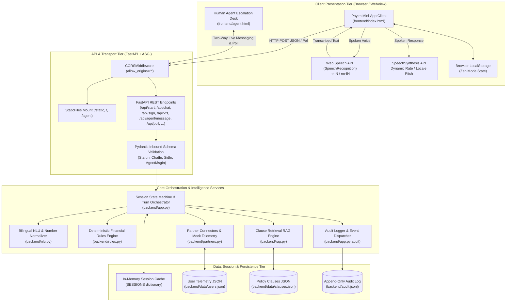
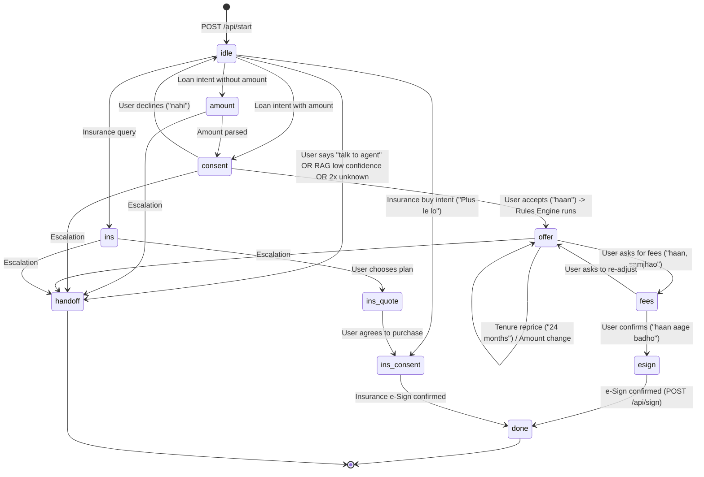
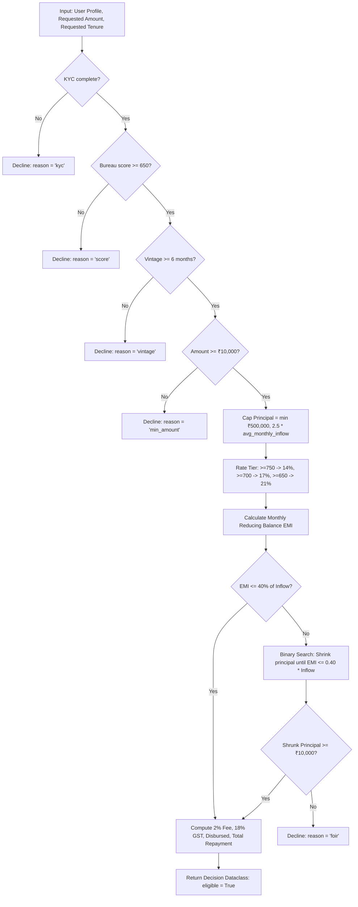
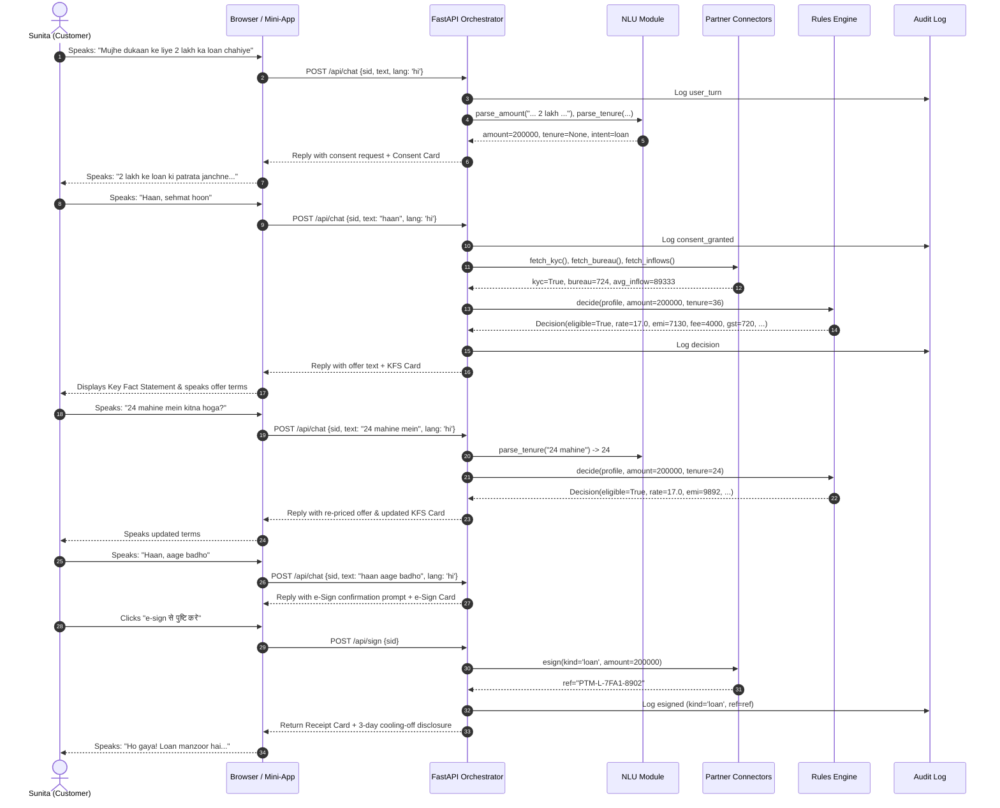

# System Architecture & Technical Specifications
## Paytm Voice Assistant · Architecture Documentation

---

## 1. Architectural Philosophy & Core Principles

The Paytm Voice Assistant is architected specifically for high-stakes fintech domains where hallucinations, non-transparent decisions, and compliance violations cannot be tolerated. The architecture is governed by three non-negotiable principles:

1. **Separation of Explanation and Calculation:** Generative or statistical language components are restricted to conversational dialogue and intent mapping. All monetary values, fees, EMIs, interest rates, eligibility criteria, and repayments are strictly governed by a deterministic, transparent rules engine (`backend/rules.py`).
2. **Clause-Grounded Knowledge (Zero Hallucination RAG):** The assistant cannot invent coverage details, room rent caps, or exclusion clauses. Queries are checked against the codified contract clauses (`backend/data/clauses.json`). When no clause confidently supports an answer, the system immediately triggers a human handoff.
3. **Purpose-Limited, Revocable Consent Lifecycle:** Conforming to India's Digital Personal Data Protection (DPDP) Act and RBI digital lending norms, partner financial data (KYC, credit scores, transaction inflows) is accessed only after explicit customer authorization. Revoking consent immediately evicts calculations and active offers from memory.

---

## 2. High-Level Component Topology



---

## 3. Subsystem Breakdown

### 3.1 Client Tier (`frontend/index.html`, `frontend/agent.html`)
The frontend is built as a zero-dependency, ultra-lightweight client suitable for embedding inside the Paytm Super-App WebView or standard desktop/mobile browsers.

- **Audio Engine:** 
  - `window.SpeechRecognition` / `window.webkitSpeechRecognition` captures continuous voice streams. Interim transcripts are rendered live into input field `$('t')`. Final transcript submission directly invokes `send()`.
  - `window.speechSynthesis` speaks responses. The voice matching the chosen language (`hi-IN` or `en-IN`) is selected automatically.
- **Dynamic Renderers:**
  - `cards()` evaluates card schemas (`consent`, `guide`, `offer`, `ins_quote`, `clause`, `compare`, `esign`, `receipt`, `decline`, `handoff`).
  - `chips()` creates quick-reply pills based on current conversation context.
- **Zen Mode Engine:**
  - Injected via CSS variables on `.zen`. Modulates palette, suppresses sharp rectangular borders, triggers CSS keyframe breathing glow (`@keyframes breathe`), and slows voice playback rate from 0.95x to 0.88x.
- **Agent Desk:**
  - Minimalist operations dashboard (`frontend/agent.html`) polling `/api/sessions` every 4,000ms. Renders real-time transcripts, raw rule decision outputs, and audit trail for handed-off sessions.

---

### 3.2 Orchestrator & State Machine (`backend/app.py`)
The orchestrator maintains multi-turn conversation states inside memory dictionary `SESSIONS`.



#### Session Schema
Each active session in `SESSIONS[sid]` holds:
```python
{
    "user": str,               # Key mapping into USERS ('sunita', 'rahul', 'meena')
    "lang": str,               # 'hi' or 'en'
    "stage": str,              # Current state machine node
    "amount": int | None,      # Active requested loan principal
    "tenure": int,             # Active loan tenure in months (default: 36)
    "consent": dict | None,    # Authorization scope and grant timestamp
    "decision": dict | None,   # Serialized dataclass output of rules.decide()
    "unknown": int,            # Counter tracking unrecognized turns
    "transcript": list[dict],  # Chronological conversation turn logs
    "audit": list[dict],       # Chronological session audit records
    "handoff": bool,           # Flag determining agent desk escalation
    "plan": str | None,        # Selected insurance plan ('basic' | 'plus')
    "product": str | None,     # 'loan' or 'insurance'
    "ref": str | None          # Transaction reference generated upon e-signing
}
```

---

### 3.3 Natural Language Understanding Service (`backend/nlu.py`)
The NLU service provides specialized parsing for Indian colloquial speech patterns:
- **Character Translation:** Converts Devanagari numerals (`०१२३४५६७८९`) into standard ASCII digits.
- **Colloquial Hindi Number Normalization:** Recognizes numeric words across Hindi and English (`ek`, `do`, `teen`, `ek lakh`, `do lakh`, `pachas hazaar`, `50k`, `2.5 lakh`).
- **Tenure Parser:** Resolves mixed phrase structures (`36 mahine`, `2 saal`, `24 months`, `1.5 years`) into standardized integer months.
- **Phrase Matchers:** Token-level and boundary-delimited phrase sets for:
  - `YES`: `["haan", "han", "yes", "ok", "theek", "sure", "agree", "हाँ", "कर दो", "आगे बढ़ो", ...]`
  - `NO`: `["nahi", "nahin", "no", "नहीं", "mat", "decline", "refuse"]`
  - `HUMAN`: `["human", "agent", "insaan", "इंसान", "executive", "बात करनी", "talk to", ...]`
  - `LOAN`: `["loan", "लोन", "udhaar", "कर्ज", "karz", "working capital"]`
  - `INS`: `["insurance", "bima", "बीमा", "policy", "cover", "waiting", "exclusion", ...]`
  - `CMP`: `["compare", "तुलना", "vs", "dono", "दोनों", "difference"]`

---

### 3.4 Deterministic Financial Rules Engine (`backend/rules.py`)
The rules engine implements mathematically sound credit decisioning.



#### Financial Formulae
- **Monthly Reducing-Balance EMI:**
  $$r_{monthly} = \frac{\text{Annual Rate}}{12 \times 100}$$
  $$\text{EMI} = P \cdot r_{monthly} \cdot \frac{(1 + r_{monthly})^n}{(1 + r_{monthly})^n - 1}$$
- **Processing Fee & Taxes:**
  $$\text{Processing Fee} = \text{round}(P \times 0.02)$$
  $$\text{GST} = \text{round}(\text{Processing Fee} \times 0.18)$$
  $$\text{Net Disbursed Amount} = P - \text{Processing Fee} - \text{GST}$$
  $$\text{Total Repayment} = \text{round}(\text{EMI} \times n)$$
  $$\text{Total Interest} = \text{Total Repayment} - P$$

---

### 3.5 Clause-Grounded RAG Engine (`backend/rag.py`)
Answers insurance policy and loan term inquiries without hallucination risk.

- **Corpus:** 14 structured clauses across `SecureHealth Basic` (SHB), `SecureHealth Plus` (SHP), and `Paytm Merchant Loan` (LN).
- **Indexing:** Bilingual stopword removal (`STOP` set contains English and Hindi conversational tokens), term-frequency extraction, and document frequency indexing (`DF`).
- **Scoring Function:**
  $$\text{IDF}(t) = \ln\left(\frac{N + 1}{\text{DF}(t) + 1}\right) + 1$$
  $$\text{Score}(q, d) = \frac{\sum_{t \in q \cap d} \text{IDF}(t) \cdot (1 + \ln(c(t, d)))}{\sqrt{|d|}}$$
- **Confidence Bounding:** Returns top-$k$ matches ($k=2$) only when $\text{Score} \ge \text{threshold}$ (default: 0.35). If no clauses meet threshold, triggers immediate fallback.

---

### 3.6 Partner Interfaces & Mock Connectors (`backend/partners.py`)
Simulates external institutional integrations:
- `fetch_kyc(user_id)`: Fetches verification status, name, city, and age.
- `fetch_bureau(user_id)`: Fetches credit bureau score.
- `fetch_inflows(user_id)`: Provides 12-month array of merchant UPI collections, average monthly inflow, platform vintage, and contextual life-event triggers.
- `esign(kind, amount)`: Generates digitally verifiable transaction identifier (`PTM-L-...` / `PTM-H-...`).

---

## 4. End-to-End Sequence Diagram (Loan Journey)



---

## 5. Security & Regulatory Compliance Architecture

### 5.1 DPDP Act (Data Protection) Architecture
- **Purpose Limitation:** Consent is tied to explicit operational scopes (`kyc`, `txn_12m`, `bureau`).
- **Revocability:** `/api/consent/revoke` sets `consent.revoked = True`, nullifies cached decision objects, resets stage to `idle`, and writes a persistent audit entry.

### 5.2 RBI Digital Lending Alignment
- **Key Fact Statement (KFS):** Automatically produced prior to agreement execution, revealing APR, loan amount, repayment frequency, processing fee, and taxes.
- **Cooling-Off Window:** All loan sanction receipts explicitly mandate and inform borrowers of their 3-day penalty-free statutory cooling-off window.

### 5.3 IRDAI Disclosure Alignment
- **Contractual Clause Attribution:** Every insurance claim regarding exclusions, waiting periods, or room rent limits is cited directly from standard policy wording, including clause reference IDs.
- **Free-Look Cancellation:** All insurance confirmation receipts communicate the 15-day free-look cancellation window.

