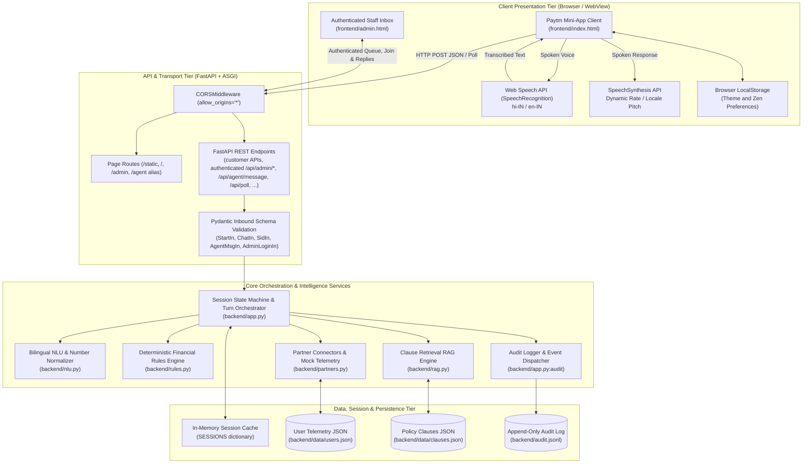
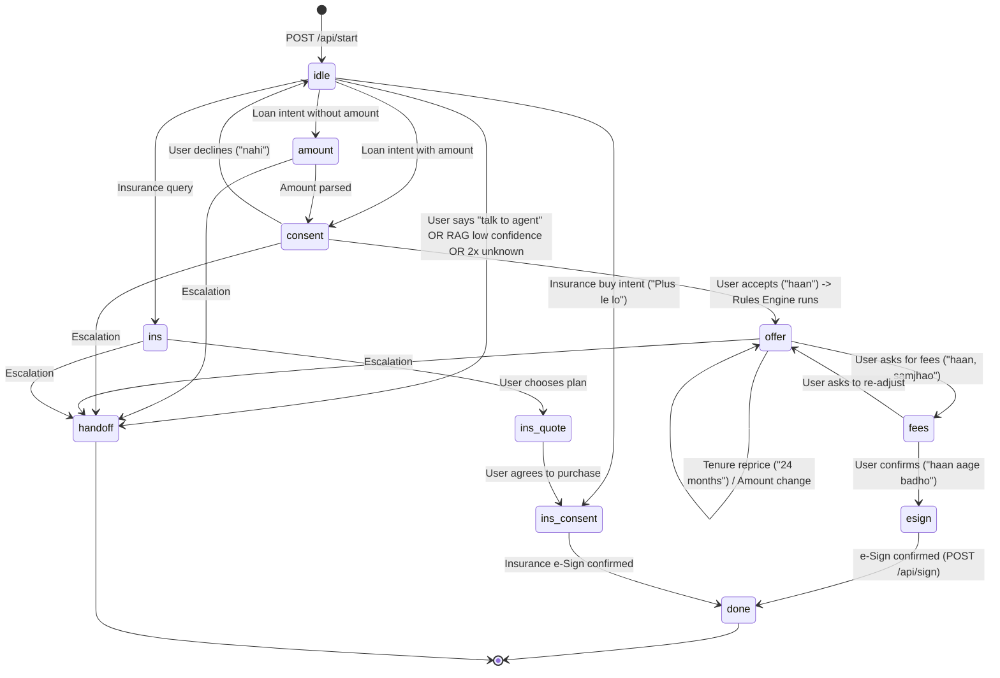
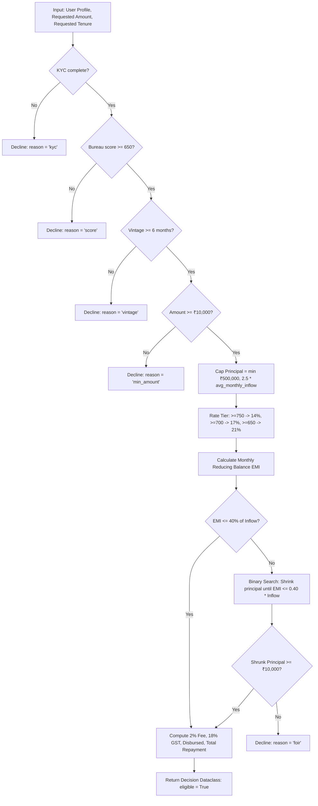
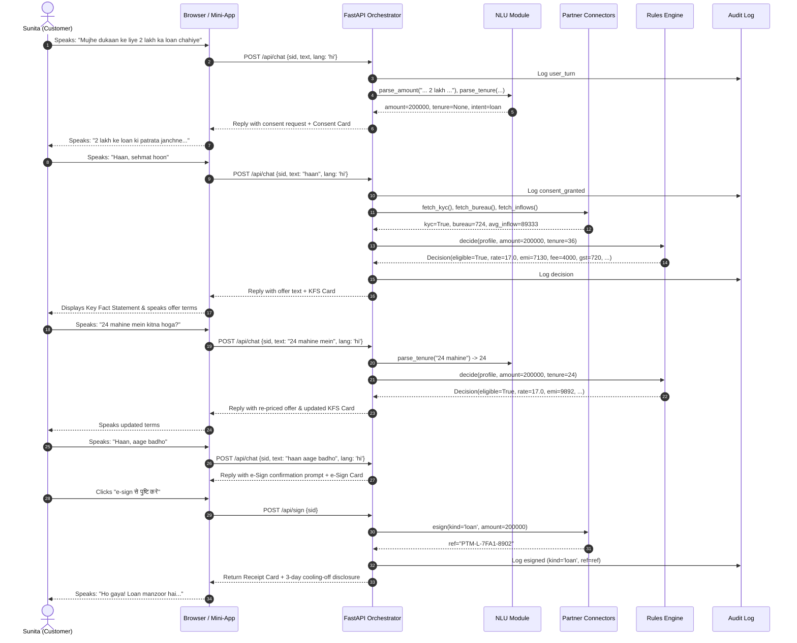

# System Architecture & Technical Specifications
## Saytm · Architecture Documentation

---

## 1. Architectural Philosophy & Core Principles

Saytm is a local demonstration of conversational financial journeys. It is not a production banking or insurance service. Its design uses three prototype principles:

1. **Separation of Explanation and Calculation:** The demo's language parsing and response flow are separate from its deterministic financial calculations. Monetary values and eligibility outcomes come from the rules engine (`backend/rules.py`), not a hosted language-model API.
2. **Clause-Grounded Retrieval:** Insurance explanations retrieve from the local sample clauses (`backend/data/clauses.json`). Low-confidence questions can be escalated rather than answered with unsupported sample policy claims.
3. **Purpose-Limited Demo Consent:** The sample flow demonstrates explicit consent before using selected mock-profile data and supports revocation. This is not a certification of legal or regulatory compliance.

---

## 2. High-Level Component Topology



---

## 3. Subsystem Breakdown

### 3.1 Client Tier (`frontend/index.html`, `frontend/admin.html`)
The frontend is a zero-dependency HTML/CSS/JavaScript demo for modern desktop and mobile browsers. It has not been validated as a production Paytm Super-App integration.

- **Audio Engine:** 
  - `window.SpeechRecognition` / `window.webkitSpeechRecognition` captures continuous voice streams. Interim transcripts are rendered live into input field `$('t')`. Final transcript submission directly invokes `send()`.
  - `window.speechSynthesis` speaks responses. The voice matching the chosen language (`hi-IN` or `en-IN`) is selected automatically.
- **Dynamic Renderers:**
  - `cards()` evaluates card schemas (`consent`, `guide`, `offer`, `ins_quote`, `clause`, `compare`, `esign`, `receipt`, `decline`, `handoff`).
  - `chips()` creates quick-reply pills based on current conversation context.
- **Zen Mode Engine:**
  - Reduces visual distractions while keeping essential account, language, theme, speech, and chat actions available. It supports both light and dark themes and persists independently from the theme selection.
- **Welcome & Account Selection:**
  - Opens without a selected customer session and speaks one short welcome line. Choosing a profile starts that customer's chat immediately; there is no Continue step.
- **Staff Inbox:**
  - `/admin` presents a sign-in screen and live queue. Authenticated staff can join a requested handoff or intervene in an active AI chat. The reply composer is gated until takeover; the customer remains on the original page. `/agent` is a compatibility alias.
- **Speech Controls:**
  - Message playback is manually controllable and can be stopped from the same speaker button. Human replies are not auto-spoken; the customer receives a spoken takeover notice.

---

### 3.2 Orchestrator & State Machine (`backend/app.py`)
The orchestrator maintains multi-turn conversation states inside memory dictionary `SESSIONS`.

- Staff credentials are configurable with `SAYTM_ADMIN_USERNAME` and `SAYTM_ADMIN_PASSWORD`; the local demo defaults are not for public deployment.
- Successful staff login creates an eight-hour HttpOnly, SameSite=Strict cookie. Queue, session detail, connect, and staff-message endpoints validate this cookie.
- Handoff state is returned to the customer poller so the customer remains in a waiting state until staff joins. An authenticated intervention can also connect an active AI session and pause subsequent AI replies.



#### Session Schema
Each active session in `SESSIONS[sid]` holds:
```python
{
    "user": str,               # Key mapping into USERS ('sunita', 'rahul', 'meena')
    "lang": str,               # 'hi' or 'en'
    "stage": str,              # Current state machine node
    "amount": int | None,      # Active requested loan principal
    "tenure": int,             # Active loan tenure in months (default: 36)
    "consent": dict | None,    # Authorization scope and grant timestamp
    "decision": dict | None,   # Serialized dataclass output of rules.decide()
    "unknown": int,            # Counter tracking unrecognized turns
    "transcript": list[dict],  # Chronological conversation turn logs
    "audit": list[dict],       # Chronological session audit records
    "handoff": bool,           # Flag determining agent desk escalation
    "plan": str | None,        # Selected insurance plan ('basic' | 'plus')
    "product": str | None,     # 'loan' or 'insurance'
    "ref": str | None          # Transaction reference generated upon e-signing
}
```

---

### 3.3 Natural Language Understanding Service (`backend/nlu.py`)
The NLU service provides specialized parsing for Indian colloquial speech patterns:
- **Character Translation:** Converts Devanagari numerals (`०१२३४५६७८९`) into standard ASCII digits.
- **Colloquial Hindi Number Normalization:** Recognizes numeric words across Hindi and English (`ek`, `do`, `teen`, `ek lakh`, `do lakh`, `pachas hazaar`, `50k`, `2.5 lakh`).
- **Tenure Parser:** Resolves mixed phrase structures (`36 mahine`, `2 saal`, `24 months`, `1.5 years`) into standardized integer months.
- **Phrase Matchers:** Token-level and boundary-delimited phrase sets for:
  - `YES`: `["haan", "han", "yes", "ok", "theek", "sure", "agree", "हाँ", "कर दो", "आगे बढ़ो", ...]`
  - `NO`: `["nahi", "nahin", "no", "नहीं", "mat", "decline", "refuse"]`
  - `HUMAN`: `["human", "agent", "insaan", "इंसान", "executive", "बात करनी", "talk to", ...]`
  - `LOAN`: `["loan", "लोन", "udhaar", "कर्ज", "karz", "working capital"]`
  - `INS`: `["insurance", "bima", "बीमा", "policy", "cover", "waiting", "exclusion", ...]`
  - `CMP`: `["compare", "तुलना", "vs", "dono", "दोनों", "difference"]`

---

### 3.4 Deterministic Financial Rules Engine (`backend/rules.py`)
The rules engine implements mathematically sound credit decisioning.



#### Financial Formulae
- **Monthly Reducing-Balance EMI:**
  $$r_{monthly} = \frac{\text{Annual Rate}}{12 \times 100}$$
  $$\text{EMI} = P \cdot r_{monthly} \cdot \frac{(1 + r_{monthly})^n}{(1 + r_{monthly})^n - 1}$$
- **Processing Fee & Taxes:**
  $$\text{Processing Fee} = \text{round}(P \times 0.02)$$
  $$\text{GST} = \text{round}(\text{Processing Fee} \times 0.18)$$
  $$\text{Net Disbursed Amount} = P - \text{Processing Fee} - \text{GST}$$
  $$\text{Total Repayment} = \text{round}(\text{EMI} \times n)$$
  $$\text{Total Interest} = \text{Total Repayment} - P$$

---

### 3.5 Clause-Grounded RAG Engine (`backend/rag.py`)
Answers insurance policy and loan term inquiries without hallucination risk.

- **Corpus:** 14 structured clauses across `SecureHealth Basic` (SHB), `SecureHealth Plus` (SHP), and `Paytm Merchant Loan` (LN).
- **Indexing:** Bilingual stopword removal (`STOP` set contains English and Hindi conversational tokens), term-frequency extraction, and document frequency indexing (`DF`).
- **Scoring Function:**
  $$\text{IDF}(t) = \ln\left(\frac{N + 1}{\text{DF}(t) + 1}\right) + 1$$
  $$\text{Score}(q, d) = \frac{\sum_{t \in q \cap d} \text{IDF}(t) \cdot (1 + \ln(c(t, d)))}{\sqrt{|d|}}$$
- **Confidence Bounding:** Returns top-$k$ matches ($k=2$) only when $\text{Score} \ge \text{threshold}$ (default: 0.35). If no clauses meet threshold, triggers immediate fallback.

---

### 3.6 Partner Interfaces & Mock Connectors (`backend/partners.py`)
Simulates external institutional integrations:
- `fetch_kyc(user_id)`: Fetches verification status, name, city, and age.
- `fetch_bureau(user_id)`: Fetches credit bureau score.
- `fetch_inflows(user_id)`: Provides 12-month array of merchant UPI collections, average monthly inflow, platform vintage, and contextual life-event triggers.
- `esign(kind, amount)`: Generates digitally verifiable transaction identifier (`PTM-L-...` / `PTM-H-...`).

---

## 4. End-to-End Sequence Diagram (Loan Journey)



---

## 5. Security & Regulatory Compliance Architecture

### 5.1 DPDP Act (Data Protection) Architecture
- **Purpose Limitation:** Consent is tied to explicit operational scopes (`kyc`, `txn_12m`, `bureau`).
- **Revocability:** `/api/consent/revoke` sets `consent.revoked = True`, nullifies cached decision objects, resets stage to `idle`, and writes a persistent audit entry.

### 5.2 RBI Digital Lending Alignment
- **Key Fact Statement (KFS):** Automatically produced prior to agreement execution, revealing APR, loan amount, repayment frequency, processing fee, and taxes.
- **Cooling-Off Window:** All loan sanction receipts explicitly mandate and inform borrowers of their 3-day penalty-free statutory cooling-off window.

### 5.3 IRDAI Disclosure Alignment
- **Contractual Clause Attribution:** Every insurance claim regarding exclusions, waiting periods, or room rent limits is cited directly from standard policy wording, including clause reference IDs.
- **Free-Look Cancellation:** All insurance confirmation receipts communicate the 15-day free-look cancellation window.
