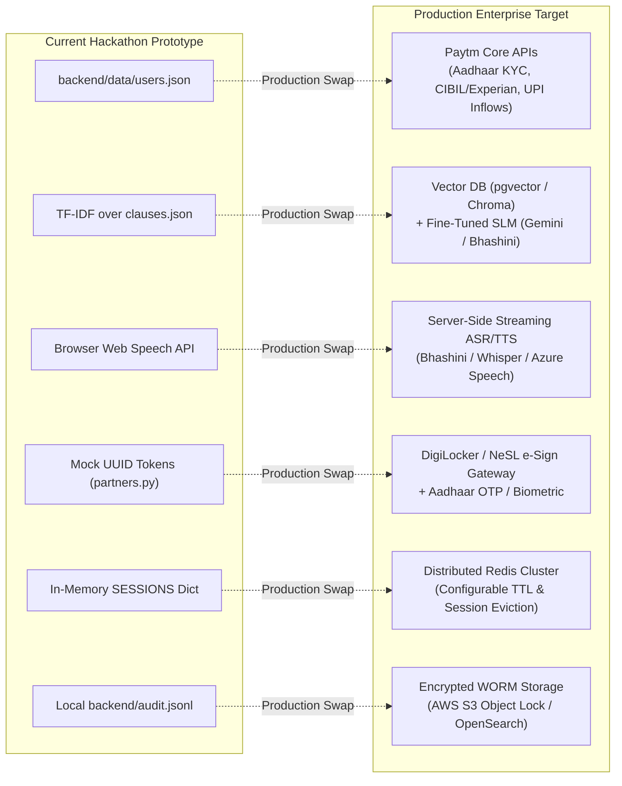

# Technology Stack & Production Migration Guide
## Paytm Voice Assistant · Technical Inventory & Evolution Path

---

## 1. Verified Technology Inventory

```
+-----------------------------------------------------------------------------------+
|                               PAYTM VOICE ASSISTANT                               |
+-----------------------------------------------------------------------------------+
| CLIENT LAYER                                                                      |
| - Vanilla HTML5 & Modern Responsive CSS3 (CSS Variables, Flexbox, CSS Grid)       |
| - Vanilla ECMAScript 6+ (Fetch API, Web Speech API, Web Audio API, LocalStorage)  |
| - Typography: Google Fonts (Hind for Devanagari/Hindi, Fraunces for Branding)     |
+-----------------------------------------------------------------------------------+
| RUNTIME & APPLICATION GATEWAY                                                     |
| - Runtime: Python 3.13 (Native String Normalization, Regex, Dataclasses)          |
| - Web Framework: FastAPI 0.115.0 (ASGI, Pydantic Inbound Schema Validation)       |
| - Application Server: Uvicorn 0.30.6 (High-Concurrency Asynchronous HTTP Server)  |
| - Test Client: HTTPX 0.27.2                                                       |
+-----------------------------------------------------------------------------------+
| CORE INTELLIGENCE ENGINES                                                         |
| - NLU: Pure Python Regex & Devanagari-to-ASCII Normalization Engine                |
| - Decisioning: Deterministic Reducing-Balance Financial Rules Engine              |
| - Retrieval (RAG): Dependency-Free Bilingual TF-IDF Vector Space Model            |
| - Telemetry / Connectors: Modular Partner Stubs (KYC, Bureau, Paytm Inflows)      |
+-----------------------------------------------------------------------------------+
| DATA & AUDITING                                                                   |
| - Master Data: JSON Flat-Files (backend/data/users.json, clauses.json)            |
| - Session Cache: Python In-Memory Hash Map (backend/app.py:SESSIONS)              |
| - Compliance Audit: Append-Only JSON Lines (backend/audit.jsonl)                  |
+-----------------------------------------------------------------------------------+
```

---

## 2. Component-by-Component Technology Matrix

| Category | Component / Library | Version | Purpose in Codebase | Justification & Architectural Benefit |
| :--- | :--- | :--- | :--- | :--- |
| **Backend Runtime** | Python | 3.13 | Core backend execution | Native support for Unicode Devanagari translation, decimal-precise math, and concise dataclass modeling. |
| **Web Framework** | FastAPI | 0.115.0 | REST API routing and middleware | High-speed ASGI performance, automatic OpenAPI documentation, clean separation of endpoint routers. |
| **Web Server** | Uvicorn | 0.30.6 | ASGI server | Asynchronous, production-ready HTTP/WebSocket server capable of non-blocking I/O. |
| **Data Validation**| Pydantic | Bundled | Inbound payload validation | Strict type safety for `StartIn`, `ChatIn`, and `SidIn` schemas, rejecting malformed client requests. |
| **HTTP Testing** | HTTPX | 0.27.2 | Integration testing | Powers FastAPI's `TestClient` in `backend/test_journeys.py` for headless end-to-end regression testing. |
| **Speech-to-Text** | Web Speech API (`SpeechRecognition`) | Native | Browser-side speech transcription | Zero-latency, zero-cost streaming voice recognition in Hindi (`hi-IN`) and Indian English (`en-IN`). |
| **Text-to-Speech** | Web Speech API (`speechSynthesis`) | Native | Spoken voice feedback | Native platform speech synthesis with customizable speech rate (`0.88x` in Zen mode, `0.95x` standard). |
| **Typography** | Google Fonts | Web | Visual branding and typography | `Hind` provides legibility for complex Devanagari ligatures; `Fraunces` renders classic serif branding. |
| **Storage (Static)**| JSON | Native | Seed data storage | Portable, human-readable storage for demo borrower profiles and insurance clauses. |
| **Compliance Log** | JSON Lines (JSONL) | Native | Regulatory audit logging | Immutable append-only log format allowing line-by-line streaming analysis by compliance auditors. |

---

## 3. Production Migration Roadmap (Prototype to Enterprise Grade)

The current architecture is intentionally structured into distinct, swappable modular abstractions. Each mock module can be replaced with production-grade enterprise services without refactoring the conversational orchestrator or frontend interface.



### Detailed Swap-In Analysis

#### 1. User & Financial Telemetry (`backend/partners.py`)
- **Current:** Synchronous reads from `backend/data/users.json`.
- **Production Swap-In:** 
  - `fetch_kyc()` connects to Paytm's Central KYC (CKYC) registry and UIDAI DigiLocker gateway.
  - `fetch_bureau()` connects to Experian or CRIF High Mark credit bureau pull microservices.
  - `fetch_inflows()` aggregates live merchant QR and soundbox settlements across 12 calendar months from Paytm Merchant Acquiring switches.

#### 2. Clause Retrieval Engine (`backend/rag.py`)
- **Current:** 45-line pure Python TF-IDF engine scoring over 14 JSON clauses.
- **Production Swap-In:** 
  - Ingestion of full IRDAI-approved policy wording PDFs (100+ pages) chunked into 300-token sections with section hierarchy metadata.
  - Dense multilingual embeddings (e.g. `multilingual-e5-small` or Bhashini AI models).
  - Storage in `pgvector` or Milvus with strict cosine-similarity threshold (>0.82) before triggering human handoff.

#### 3. Voice & Speech Pipeline (`frontend/index.html`)
- **Current:** Browser-native `webkitSpeechRecognition` and `speechSynthesis`.
- **Production Swap-In:** 
  - Integration with Bhashini (Government of India National Language Translation Mission) or OpenAI Whisper running on an internal low-latency inference cluster.
  - WebSocket audio streaming directly from the Paytm native Android/iOS mini-app bridge.
  - Neural text-to-speech with natural Indian regional inflections and background noise suppression.

#### 4. Electronic Signature (`backend/partners.py:esign`)
- **Current:** Formatted mock string `PTM-L-[HEX]-[TIMESTAMP]`.
- **Production Swap-In:** 
  - Legal electronic signature via CDAC / NSDL Aadhaar OTP gateway or NeSL Digital Document Execution (DDE) platform.
  - Automatic generation of a legally binding, cryptographically signed Key Fact Statement (KFS) stored in DigiLocker.

#### 5. Session State & Scalability (`backend/app.py:SESSIONS`)
- **Current:** Python dictionary `SESSIONS: dict = {}`.
- **Production Swap-In:**
  - Redis 7.x cluster with replication, automatic key eviction, and encrypted transit.
  - Session state serialization via msgpack for sub-millisecond retrieval across multiple stateless FastAPI worker pods.

#### 6. Regulatory Audit & Compliance Stream (`backend/app.py:audit`)
- **Current:** Local append-only `backend/audit.jsonl`.
- **Production Swap-In:**
  - Streaming event dispatcher publishing to an Apache Kafka or AWS Kinesis topic.
  - Immutable WORM (Write Once, Read Many) storage in Amazon S3 Object Lock for DPDP Act compliance, retaining records for the statutory 7-year financial audit window.

---

## 4. Hardware & Client Compatibility Matrix

| Environment | Supported | Audio Input (STT) | Audio Output (TTS) | Visual & Zen Mode |
| :--- | :--- | :--- | :--- | :--- |
| **Google Chrome (Desktop / Android)** | **Yes (Full)** | Supported (`webkitSpeechRecognition`) | Supported (`SpeechSynthesis`) | Supported |
| **Microsoft Edge (Desktop / Mobile)** | **Yes (Full)** | Supported (`SpeechRecognition`) | Supported (`SpeechSynthesis`) | Supported |
| **Apple Safari (iOS 15+ / macOS)** | **Partial** | Fallback to typed text / chips | Supported (`SpeechSynthesis`) | Supported |
| **Mozilla Firefox** | **Partial** | Fallback to typed text / chips | Supported (`SpeechSynthesis`) | Supported |
| **Paytm Native Android Mini-App** | **Yes (Full)** | Via WebView Chrome Bridge | Via Native Audio Bridge | Supported |

