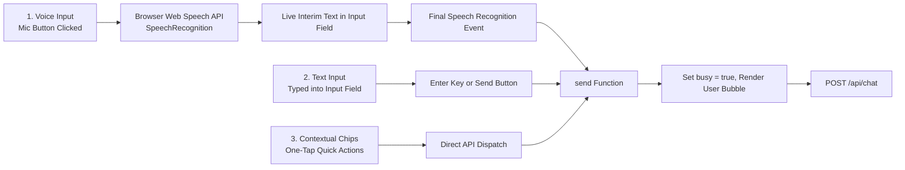
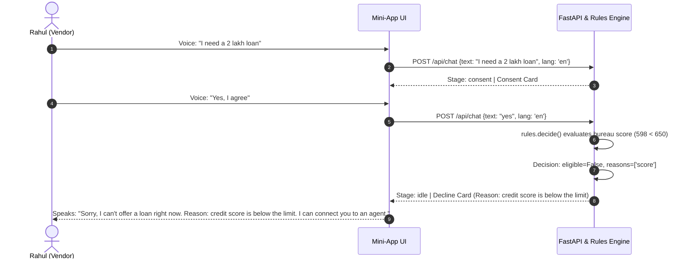
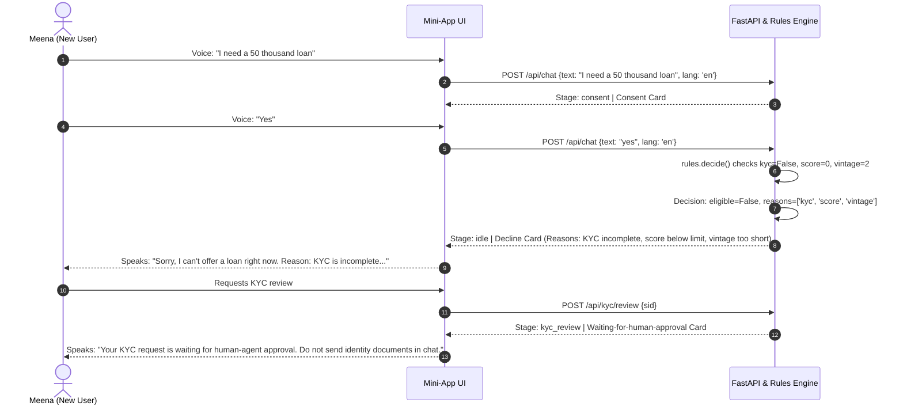

# End-to-End Application Workflow & Journey Guide
## Paytm Voice Assistant · Operational & Conversational Workflows

---

## 1. Application Initialization & Startup Flow

```mermaid
sequenceDiagram
    autonumber
    actor User as Customer
    participant Browser as Browser Client (index.html)
    participant Server as FastAPI Server (backend/app.py)
    participant Storage as Demo customer profiles

    User->>Browser: Opens http://localhost:8000
    Browser->>Browser: Loads HTML, CSS, Hind fonts, initializes DOM
    Browser->>Browser: Reads localStorage('paytm-zen') -> restores Zen state
    Browser->>Browser: Render welcome; speak one short welcome line
    User->>Browser: Open profile menu and select customer account
    Browser->>Server: POST /api/start {user, lang}
    Server->>Storage: Load selected demo customer profile
    Server->>Server: Create new session in SESSIONS[sid]
    Server->>Server: Audit event: session_start
    Server-->>Browser: JSON {sid, reply, cards, chips, profile}
    Browser->>Browser: Render chat and account greeting
```

### Detailed Startup Steps:
1. **Client Loading:** The browser requests `GET /`, serving `frontend/index.html`.
2. **State Hydration:** JavaScript inspects `localStorage.getItem('paytm-zen')`. If set to `1`, the document body is decorated with class `.zen`, enabling calm colors and the breathing glow background.
3. **Welcome:** The customer sees a short welcome and hears one spoken welcome line; no profile is selected and no customer session is created yet.
4. **Session Genesis:** Selecting an account in the profile menu immediately issues `POST /api/start`.
5. **Backend Orchestration:** `app.py:start()` generates a unique 8-character session ID (`sid`), creates `SESSIONS[sid]`, and loads the selected demo profile.
6. **Proactive Financial Guidance:** If the selected customer has a `hint`, the backend returns a personalized greeting and guide card. The personalized greeting is read aloud when the chat starts.

---

## 2. Interaction Modes & Input Processing

Users can interact through three synchronized modalities:



---

## 3. Core Journey Workflows

### Journey 1: Sunita · Merchant Loan Review & Dynamic Repricing Flow

- **Persona Context:** Sunita, 34, Kanpur. Kirana merchant with 26-month platform vintage, ₹89,333 average monthly inflows, bureau score 724, and completed KYC.
- **Goal:** Request review for a ₹2,00,000 working-capital loan after adjusting tenure from 36 to 24 months.

```mermaid
sequenceDiagram
    autonumber
    actor Sunita as Sunita (Kirana Merchant)
    participant UI as Mini-App UI
    participant Backend as FastAPI & Rules Engine

    Sunita->>UI: Voice: "Mujhe dukaan ke liye 2 lakh ka loan chahiye"
    UI->>Backend: POST /api/chat {text, lang: 'hi'}
    Backend-->>UI: Stage: consent | Consent Card (KYC, Inflows, Bureau)
    UI-->>Sunita: Speaks: "2 lakh ke loan ki patrata janchne..."

    Sunita->>UI: Voice: "Haan, sehmat hoon" (or taps 'मैं सहमत हूँ')
    UI->>Backend: POST /api/chat {text: "haan", lang: 'hi'}
    Backend->>Backend: Fetch telemetry -> Run rules.decide()
    Backend-->>UI: Stage: offer | KFS Offer Card (Amount: ₹2,00,000, 36m, EMI: ₹7,130, 17% p.a.)
    UI-->>Sunita: Speaks offer terms and asks: "Fees aur interest simple shabdon mein samjhaun?"

    Sunita->>UI: Voice: "24 mahine mein"
    UI->>Backend: POST /api/chat {text: "24 mahine mein", lang: 'hi'}
    Backend->>Backend: Reprice via rules.decide(amount=200000, tenure=24)
    Backend-->>UI: Stage: offer | Repriced KFS Card (24m, EMI: ₹9,892, 17% p.a.)
    UI-->>Sunita: Speaks: "Aap 2,00,000 tak ke liye eligible hain. 24 mahine mein EMI lagbhag 9,892..."

    Sunita->>UI: Voice: "Haan, samjhao"
    UI->>Backend: POST /api/chat {text: "haan, samjhao", lang: 'hi'}
    Backend-->>UI: Stage: fees | Fee Breakdown (Proc Fee: ₹4,000, GST: ₹720, Disbursed: ₹1,95,280)
    UI-->>Sunita: Speaks transparent net disbursement and total repayment

    Sunita->>UI: Voice: "Haan aage badho"
    UI->>Backend: POST /api/chat {text: "haan aage badho", lang: 'hi'}
    Backend-->>UI: Stage: esign | e-Sign Review Request Card
    UI-->>Sunita: Speaks: "Review the Key Fact Statement; sending an e-sign request asks a human agent to review it."

    Sunita->>UI: Taps "e-sign अनुरोध भेजें"
    UI->>Backend: POST /api/sign {sid}
    Backend->>Backend: Mark signature review pending; queue for a human agent
    Backend-->>UI: Stage: signature_review | Waiting-for-approval Card
    UI-->>Sunita: Speaks: "Your e-sign request is waiting for human-agent approval; the loan is not active yet."
    StaffInbox->>Backend: Review request and reply to customer
```

---

### Journey 2: Rahul · Credit Score Decline & Explainability Flow

- **Persona Context:** Rahul, 41, Noida. Street-food vendor with verified KYC, 9-month platform vintage, but credit score of 598 (below the 650 threshold).
- **Goal:** Attempt ₹2,00,000 loan; understand why the platform cannot disburse immediately.



---

### Journey 3: Meena · Incomplete KYC Guardrail Flow

- **Persona Context:** Meena, 22, Jaipur. New user with unverified KYC, 2-month platform vintage, zero bureau history.
- **Goal:** Attempt ₹50,000 micro-loan; receive explicit guidance on prerequisites.



---

### Journey 4: Health Insurance Clause Inquiry, Comparison & Purchase Review Flow

- **Goal:** Inquire about pre-existing disease waiting periods, compare Basic vs Plus plans, select Plus, and request human review of the e-sign.

```mermaid
sequenceDiagram
    autonumber
    actor User as Insurance Customer
    participant UI as Mini-App UI
    participant Backend as FastAPI & RAG Engine

    User->>UI: Voice: "waiting period kya hai?"
    UI->>Backend: POST /api/chat {text: "waiting period kya hai?", lang: 'hi'}
    Backend->>Backend: RAG retrieve(): matches SHB-4.1 (score 0.65) and SHP-4.1 (score 0.65)
    Backend-->>UI: Clause Cards (SHB-4.1: 4 years, SHP-4.1: 2 years)
    UI-->>User: Speaks: "पहले से मौजूद बीमारियाँ Basic में 4 साल..."

    User->>UI: Voice: "dono plan compare karo"
    UI->>Backend: POST /api/chat {text: "dono plan compare karo", lang: 'hi'}
    Backend-->>UI: Comparison Table Card (Premium, Sum Insured, Waiting, Room Rent, Co-pay)
    UI-->>User: Speaks: "Plus में इंतज़ार कम (2 साल), कमरे की सीमा नहीं..."

    User->>UI: Voice: "Plus le lo"
    UI->>Backend: POST /api/chat {text: "Plus le lo", lang: 'hi'}
    Backend-->>UI: Stage: ins_consent | Consent Card (Scope: KYC name, Age)
    UI-->>User: Speaks: "SecureHealth Plus खरीदने के लिए KYC नाम और उम्र देखनी होगी..."

    User->>UI: Voice: "Haan"
    UI->>Backend: POST /api/chat {text: "haan", lang: 'hi'}
    Backend-->>UI: Stage: ins_quote | Quote Card (₹12,900/yr, ₹10 lakh cover) + e-Sign Card
    
    User->>UI: Taps "e-sign अनुरोध भेजें"
    UI->>Backend: POST /api/sign {sid}
    Backend->>Backend: Mark signature review pending; queue for a human agent
    Backend-->>UI: Stage: signature_review | Waiting-for-approval Card
    UI-->>User: Speaks: "Your e-sign request is waiting for human-agent approval; the policy is not active yet."
    StaffInbox->>Backend: Review request and reply to customer
```

---

### Journey 5: Fallback & Human Agent Handoff Flow

- **Trigger 1:** Explicit request: "Agent se baat karo" / "Talk to an agent".
- **Trigger 2:** Low RAG confidence: Out-of-domain questions ("are dinosaur bites covered?").
- **Trigger 3:** Repeated misunderstanding: Two consecutive unclassified queries.

```mermaid
sequenceDiagram
    autonumber
    actor User as Customer
    participant UI as Customer Mini-App
    participant Backend as FastAPI Orchestrator
    participant StaffInbox as Staff Inbox (/admin)

    User->>UI: Voice: "are dinosaur bites covered in this policy?"
    UI->>Backend: POST /api/chat {text: "...", lang: 'en'}
    Backend->>Backend: RAG search fails (score < 0.32)
    Backend->>Backend: Trigger handoff(reason='no_supporting_clause', nofound=True)
    Backend->>Backend: Audit event: handoff
    Backend-->>UI: Stage: handoff | Handoff Card ("Connecting you to a human agent now...")
    UI-->>User: Speaks handoff disclosure

    UI-->>User: Show waiting state in the existing customer chat
    Note over StaffInbox: Staff signs in to /admin
    StaffInbox->>Backend: GET /api/admin/sessions (authenticated)
    Backend-->>StaffInbox: Active AI chats and waiting handoffs, with handoffs listed first
    StaffInbox->>Backend: GET /api/admin/session/{sid} (authenticated)
    Backend-->>StaffInbox: Full session transcript, profile, and audit log
    StaffInbox->>Backend: POST /api/admin/session/{sid}/connect (handoff) or /intervene (active AI chat)
    Backend->>Backend: Pause AI replies and enable human-agent messages
    Backend-->>UI: Customer poll reports a connected agent
    Note over StaffInbox,UI: Staff replies in the inbox; the customer remains in the same chat
```

---

## 4. Supporting Operational Workflows

### 4.1 Data Consent Revocation Workflow
1. User clicks **"Revoke consent"** link in tools bar (`frontend/index.html:213`).
2. Client calls `POST /api/consent/revoke` passing `{sid}`.
3. Backend marks `s["consent"]["revoked"] = True`, clears `s["decision"] = None`, and resets `s["stage"] = "idle"`.
4. Backend writes `audit(sid, "consent_revoked")`.
5. Frontend informs user: *"आपकी डेटा-मंज़ूरी वापस ले ली गई है।"* (Your data consent has been revoked).

### 4.2 Audit Log
Session events continue to be recorded in the backend audit trail for operational traceability. The raw audit log is not exposed as a customer-facing chat control.

### 4.3 Human-Agent Reply Controls
The staff inbox shows active AI conversations for monitoring, but keeps the reply composer hidden until the AI requests a handoff or staff explicitly chooses **Intervene in AI chat**. Joining or intervening marks the session as human-connected; subsequent customer messages are recorded for the agent without invoking another AI reply. Human-authored messages are not read automatically; either side can use the message speaker button to hear a specific message.

### 4.4 Display Theme
The customer app and staff inbox share a persistent light/dark theme preference. The staff inbox uses neutral white/gray gradients in light mode and charcoal gradients in dark mode.

### 4.5 Zen Mode (Cognitive Accessibility) Workflow
1. User clicks **"🧘 Zen"** button or presses `Alt+Z` keyboard shortcut.
2. JavaScript toggles CSS class `document.body.classList.toggle('zen')`.
3. Background ambient glow fades in with a gentle 9-second ease-in-out breathing cycle (`@keyframes breathe`).
4. Speech synthesis rate drops from `0.95` to `0.88`, ensuring clear, relaxed narration.
5. Mode preference is saved to `localStorage.setItem('paytm-zen', '1')` and restored automatically on next visit.

### 4.6 Official RBI Key Fact Statement (KFS) Inspection & Print Workflow
1. When loan offer is presented or signed, user clicks **"📄 View Official RBI KFS"**.
2. Frontend requests `GET /api/kfs/{sid}`.
3. Backend produces official disclosure payload: effective APR, 6-month amortization preview, 3-day cooling-off declarations, and nodal officer contacts.
4. Native `<dialog id="kfs_dlg">` displays the formatted KFS with a **"🖨️ Print / Save PDF"** button invoking `window.print()`.

### 4.5 Staff Inbox & Human Handoff Workflow
1. A customer requests a human or a guarded answer triggers `handoff()`. The customer sees a waiting state and stays on the current chat page.
2. Staff opens `/admin`, signs in, and selects a waiting chat from the live queue.
3. Staff clicks **Join conversation**; the backend records the connection and the customer chat updates its waiting status.
4. Staff replies through `POST /api/agent/message`; this endpoint and the inbox/session endpoints require the admin session cookie.
5. The customer mini-app polls `/api/poll/{sid}`, renders the staff message, and reads it aloud when read-aloud is enabled.

### 4.6 Voice Input and Output Controls
1. The microphone uses the browser Speech Recognition API; unsupported browsers and permission or network errors receive an on-screen explanation.
2. The volume slider controls speech synthesis and remembers the chosen level. Its speaker button mutes and stops any active narration.
3. The **Read aloud** toggle controls automatic assistant narration. Each message also has a speaker button that toggles playback for that specific message.
4. Changing the language or theme reads the welcome line in the selected language. Speech spells Saytm as “Say, tee-em” with a brief pause.
5. A KYC or e-sign request waits for human review; it does not play an approval chime or generate an approval receipt.
